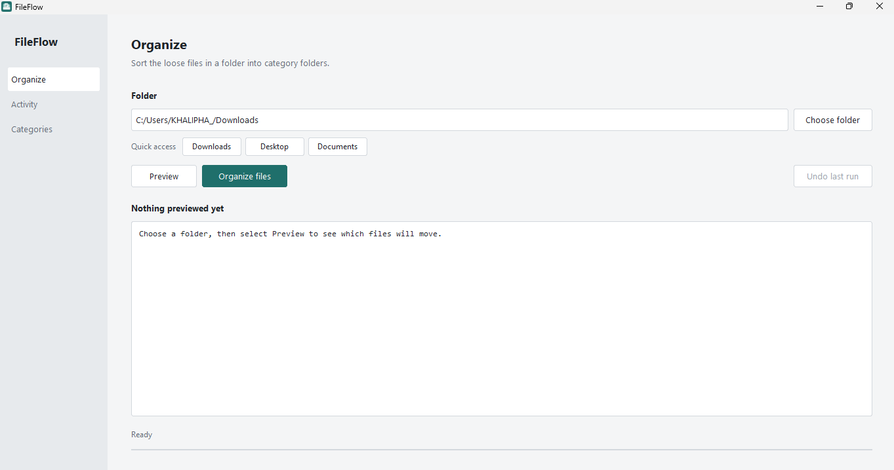
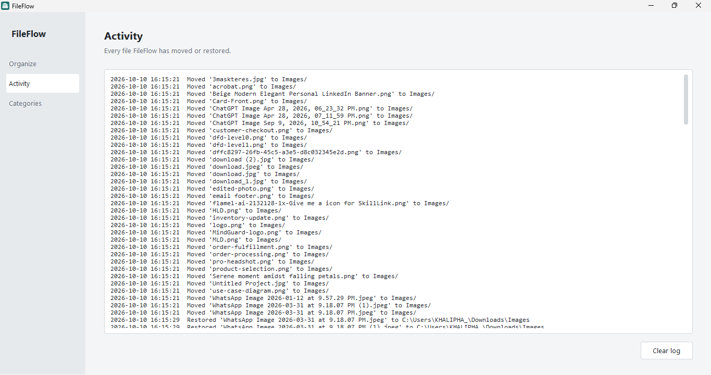
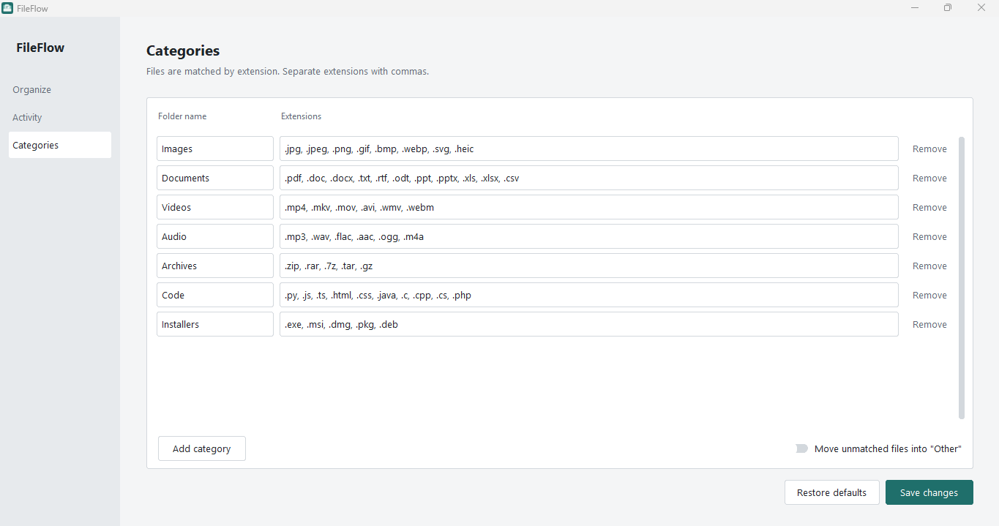

<p align="center">
  
</p>

<h1 align="center">FileFlow</h1>

<p align="center">
  A desktop app that sorts the loose files in a folder into category folders, with preview and undo.
</p>





## What it does

Point FileFlow at a folder such as Downloads and it moves each file into a folder based on its extension: images into `Images`, PDFs into `Documents`, and so on. Nothing is deleted or overwritten, and every run can be undone.

- **Preview first.** See exactly which files will move, and where, before anything changes.
- **Undo.** Reverse the last organize run, or keep stepping back through the last 25.
- **Quick access.** One click to work on Downloads, Desktop or Documents, including folders that OneDrive has redirected. On first launch it starts on Downloads.
- **Editable categories.** Add, remove or rename categories and change their extensions.
- **Safe by default.** Name clashes are renamed (`photo.jpg` becomes `photo_1.jpg`), hidden and system files are skipped, and subfolders are left alone.
- **Stays responsive.** Large folders are processed in the background with a progress bar.
- **Activity log.** A record of every file moved or restored.

## Install

### Windows installer

Download `FileFlow-Setup-2.0.0.exe` from the [Releases](https://github.com/Khalipha-Samela/FileFlow/releases) page and run it. It installs for the current user, so no admin rights are needed.

Windows SmartScreen may warn about an unknown publisher because the installer isn't code-signed. Choose **More info**, then **Run anyway**.

### Run from source

Requires Python 3.10 or newer.

```powershell
git clone https://github.com/Khalipha-Samela/FileFlow.git
cd FileFlow
python -m venv .venv
.venv\Scripts\Activate.ps1
python -m pip install -r requirements.txt
python FileFlow.py
```

On macOS or Linux, activate the environment with `source .venv/bin/activate` instead.

## Using it

1. Pick a folder with a **Quick access** button or **Choose folder**.
2. Select **Preview** to see what will move. Nothing changes yet.
3. Select **Organize files** and confirm.
4. Changed your mind? Select **Undo last run**.

### Default categories

| Folder | Extensions |
| --- | --- |
| Images | `.jpg` `.jpeg` `.png` `.gif` `.bmp` `.webp` `.svg` `.heic` |
| Documents | `.pdf` `.doc` `.docx` `.txt` `.rtf` `.odt` `.ppt` `.pptx` `.xls` `.xlsx` `.csv` |
| Videos | `.mp4` `.mkv` `.mov` `.avi` `.wmv` `.webm` |
| Audio | `.mp3` `.wav` `.flac` `.aac` `.ogg` `.m4a` |
| Archives | `.zip` `.rar` `.7z` `.tar` `.gz` |
| Code | `.py` `.js` `.ts` `.html` `.css` `.java` `.c` `.cpp` `.cs` `.php` |
| Installers | `.exe` `.msi` `.dmg` `.pkg` `.deb` |

Edit these on the **Categories** page. Turn on **Move unmatched files into "Other"** if you want files with unknown extensions sorted too. If an extension appears in more than one category, the first category in the list wins.

## Where your data is stored

Settings, undo history and the activity log live outside the app folder:

| System | Location |
| --- | --- |
| Windows | `%APPDATA%\FileFlow` |
| macOS | `~/Library/Application Support/FileFlow` |
| Linux | `~/.config/FileFlow` |

The files are `settings.json`, `runs.json` and `activity.log`. Deleting that folder resets the app to its defaults.

## Building from source

Build the executable:

```powershell
python -m pip install pyinstaller
python -m PyInstaller --noconsole --onefile --name FileFlow --icon icon.ico --add-data "icon.ico;." --collect-all customtkinter FileFlow.py
```

This produces `dist\FileFlow.exe`. To turn it into an installer, install [Inno Setup 6](https://jrsoftware.org/isinfo.php), open `FileFlow.iss` and choose **Build > Compile**. The installer is written to `installer\`.

To regenerate the icon files after changing colors, run `python make_icon.py` (requires Pillow).

## Project structure

```
FileFlow.py      Interface: the App window and its three pages
organizer.py     Logic: settings, planning, organizing, undo, logging (no UI code)
FileFlow.iss     Inno Setup installer script
make_icon.py     Generates icon.ico, icon.png and icon.svg
icon.*           App icon
requirements.txt Python dependencies
```

The logic in `organizer.py` has no dependency on the interface, so it can be tested or reused on its own.

## Roadmap

- Drag and drop folder selection
- Theme switching (light and dark)
- Cloud folder integration

## License

[MIT](LICENSE)

## Author

Khalipha Samela

## Built with

- Python
- [CustomTkinter](https://github.com/TomSchimansky/CustomTkinter)
- PyInstaller and Inno Setup for packaging