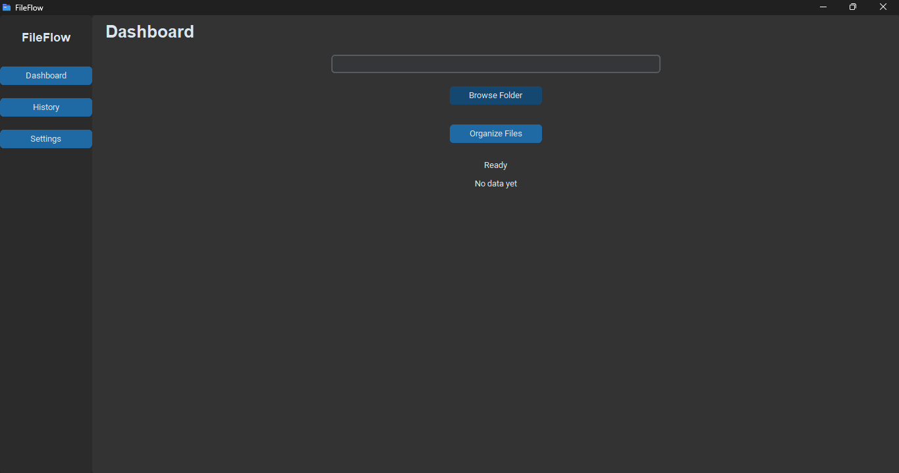
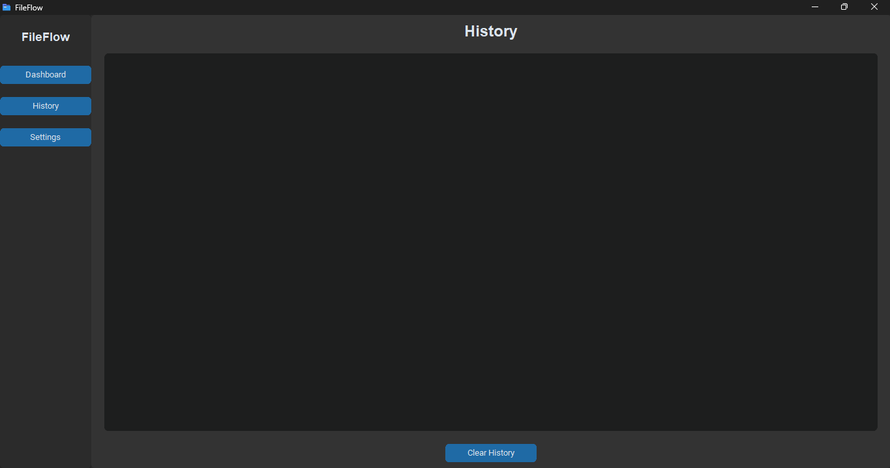
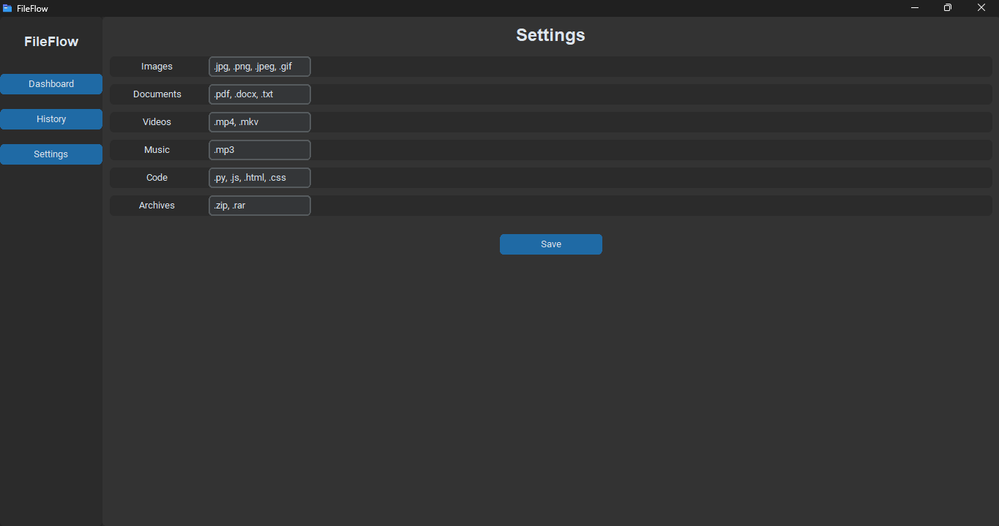

# 🚀 FileFlow — Smart File Organizer

FileFlow is a modern desktop application built with Python and CustomTkinter that automatically organizes files into categorized folders based on their extensions. It features a sleek UI, file history tracking, and customizable settings.

---

## ✨ Features

- 📂 One-click file organization
- 🧠 Smart categorization using file extensions
- ⚙️ Editable categories via settings UI
- 📊 Real-time stats dashboard
- 📝 File movement history tracking
- 💾 Remembers last selected folder
- 🎨 Modern UI built with CustomTkinter
- ⚡ Smooth splash screen experience
- 🖥️ Screenshots

---

## 📸 Screenshots

 <br>
 <br>


---

## 🧩 How It Works


---

## 📦 Installation

1. Clone the repository
```bash
git clone https://github.com/Khalipha-Samela/FileFlow.git
cd FileFlow
```

2. Install dependencies
```bash
python -m pip install -r requirements.txt
```

3. Run the app
```bash
python FileFlow.py
```
---

## 📁 Project Structure

fileflow/
│
├── FileFlow.py          # Main app
├── config.json          # File categories
├── history.txt          # Logs
├── last_folder.txt      # Saved folder path
├── icon.ico             # App icon
│
├── assets/              # Screenshots & branding
│   ├── dashboard.png
│   ├── stats.png
│   └── settings.png
│
├── requirements.txt
└── README.md

---

## ⚙️ Default Configuration
```JSON
{
  "Images": [".jpg", ".png", ".jpeg", ".gif", ".webp"],
  "Documents": [".pdf", ".docx", ".txt", ".xlsx", ".pptx"],
  "Videos": [".mp4", ".mkv", ".avi", ".mov"],
  "Music": [".mp3", ".wav"],
  "Code": [".py", ".js", ".html", ".css", ".java", ".cpp"],
  "Archives": [".zip", ".rar", ".7z"]
}
```

---

## 🧪 Build Executable (Optional)
```bash
python -m pip install pyinstaller
pyinstaller --onefile --windowed --icon=icon.ico FileFlow.py
```

---

## 🧠 Example Output

Before:
```
Downloads/
  file1.jpg
  doc1.pdf
  video.mp4
```

After:
```
Downloads/
  Images/
  Documents/
  Videos/
```

---

## ⚠️ Known Issues
- Missing ```icon.ico``` may cause errors in ```.exe``` builds
- ```config.json``` must exist before organizing files

---

## 🛣️ Roadmap
- Drag & drop folder selection
- Undo file organization
- File preview before sorting
- Theme switching (dark/light mode)
- Cloud integration

---

## 🤝 Contributing

Contributions are welcome!
```bash
git checkout -b feature/new-feature
git commit -m "Add new feature"
git push origin feature/new-feature
```

---

## 📜 License

MIT License

---

## 👨‍💻 Author

**Khalipha Samela**
Aspiring Software Developer

---

## ⭐ Support

If you like this project:
- ⭐ Star the repo
- 🍴 Fork it
- 📢 Share it